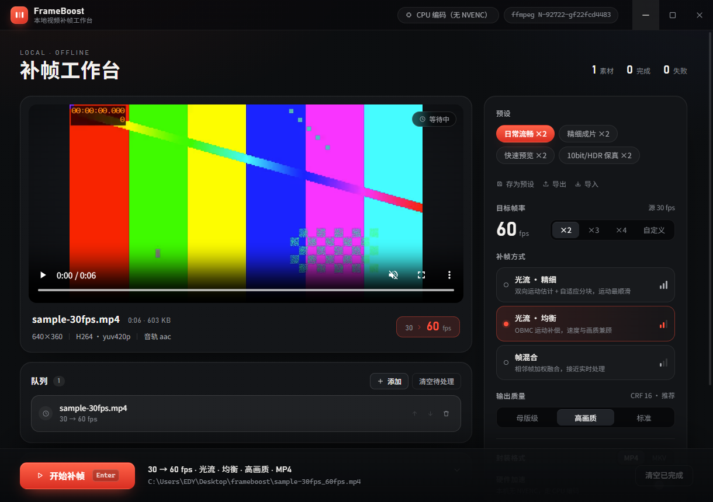

# ⚡ FrameBoost (帧跃) · 本地极速视频 AI 补帧神器

<p align="center">
  
</p>

<p align="center">
  <b>让你的视频秒变 60 / 120 帧丝滑高刷！免费开源、GPU 极速硬件加速的本地离线视频补帧工具</b><br>
  一键将 24/30fps 动漫、老电影、游戏高光平滑插帧至 60/90/120fps · 原生支持 NVENC 硬件加速与 HDR 画质 · 绿色免安装开箱即用
</p>

<p align="center">
  <a href="./README.en.md">English Documentation</a> | <b>简体中文</b>
</p>

<p align="center">
  
  
  
  
  
  
</p>

<p align="center">
  <a href="https://github.com/zhangtt08/video-frame-interpolator/releases/latest"><b>🚀 [点击立即下载 Windows 绿色免安装版 FrameBoost.exe]</b></a>
</p>

<p align="center">
  
  <br>
  <em>左侧实时显示素材与播放预览，右侧参数轻松调节，底部实时呈现进度与剩余时间</em>
</p>

---

## ⚡ 为什么选择 FrameBoost？

你是否有过这样的体验：
- **想看 60 帧 / 120 帧丝滑流畅的高刷动漫或经典电影**，但视频网站要么需要开高昂会员，要么根本没有高帧率选项；
- **网络上的在线 AI 补帧工具**：按分钟收费极贵、限制文件大小、还要排长队等待，更担心个人视频隐私泄露；
- **传统命令行工具太折磨**：参数复杂繁琐，动辄报错崩溃，还经常遇到画面闪烁、变色（HDR 发灰）或音画不同步的恼人问题。

**FrameBoost 就是为你量身打造的终极解决方案！**  
无需配置 Python 或繁琐 CUDA 环境，自带精美桌面界面与开箱即用的 FFmpeg 补帧引擎。把视频往窗口里一拖，一键开启电影级丝滑补帧体验！

---

## ✨ 核心特性

- 🚀 **一键提升至 60 / 120 帧**：自由指定目标帧率（60fps、90fps、120fps 或任意倍率），画面行云流水。
- ⚡ **GPU 硬件极速加速**：深度集成 NVIDIA NVENC 硬件编解码，多核并发处理，导出速度数倍提升；无独显也能自动调用多核 CPU 平稳运行。
- 🌈 **HDR 与 10-bit 色彩穿透**：无损保留 BT.709 / BT.2020 / PQ / HLG 色彩空间，色彩不发灰，还原母带级艳丽画质。
- 🎯 **精准对齐与零音画脱节**：内置创新的运动补偿平滑算法，杜绝传统补帧尾部丢帧问题，确保音频与视频分秒不差。
- 🔒 **100% 本地纯离线**：全部计算均在本机 GPU/CPU 运行，不消耗任何外网流量，完全保障隐私安全。
- 📋 **批量处理队列**：支持拖入多部视频批量排队插帧，自动跳过异常，完成后系统弹窗提醒。
- 🤖 **原生支持 AI Agent / MCP**：内置 REST API 与 MCP 服务，支持 Cursor、Claude Code 等智能体自动化批量调用。

---

## 🎛️ 三种预设模式，随心选择

| 模式 | 核心特点 | 最适合场景 |
| :--- | :--- | :--- |
| 🌟 **动漫/电影模式（极致平滑 · 强烈推荐）** | 双向运动估计 + 变切加权，线条过度极致柔和，几乎无撕裂感 | 24fps 动漫观影、经典老电影、慢动作特写升格 |
| ⚡ **平衡模式（日常推荐 · 速度与画质兼顾）** | 速度与画面效果极佳平衡，运动补偿自然精准 | 日常实拍 Vlog、短视频、纪录片、发布会录像 |
| 🚀 **极速模式（超快导出）** | 计算速度极快，CPU/GPU 占用极低，快速消除运动画面闪烁 | 游戏高光回放、低配电脑快速预览、大批量转码 |

---

## 📥 极速上手

### 方式一：直接运行桌面版（开箱即用，强烈推荐）
1. 前往 **[Releases 页面](https://github.com/zhangtt08/video-frame-interpolator/releases/latest)** 下载最新的 **`FrameBoost.exe`**；
2. 双击打开（绿色免安装，内置所有依赖与编解码库）；
3. 将你想补帧的视频拖入窗口，选择目标帧率（如 60fps）与预设模式；
4. 点击「开始补帧」，静候片刻即可得到丝滑成片！

### 方式二：开发者源码运行
```bash
git clone https://github.com/zhangtt08/video-frame-interpolator.git
cd video-frame-interpolator
npm install
npm run dev
```

---

## 🤖 AI Agent 与 MCP 集成

FrameBoost 原生开放面向 AI 智能体的本地服务：

```bash
# 启动本地服务（默认端口 8791）
npm run agent:serve
```

已支持 `frameboost.probe`（视频参数探测）、`frameboost.interpolate`（自动化补帧执行）、`frameboost.status`（查询进度与状态）等工具。在 Cursor、Claude Code 中配置后即可让 AI 全自动调帧！

---

## ⭐ 支持与致谢

如果 FrameBoost 让你心爱的动漫或视频变得更加行云流水，请在 GitHub 上为本项目点一个 **Star ⭐** 吧！你的支持是持续维护与迭代的最大动力。

## 📄 开源许可证
本项目基于 [MIT License](LICENSE) 协议开源。
